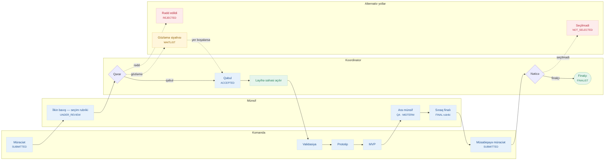
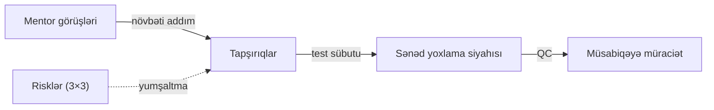
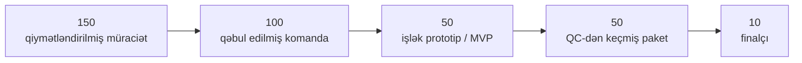
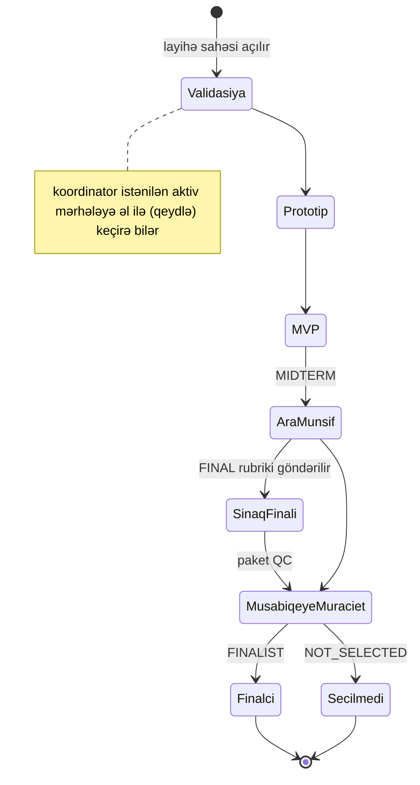
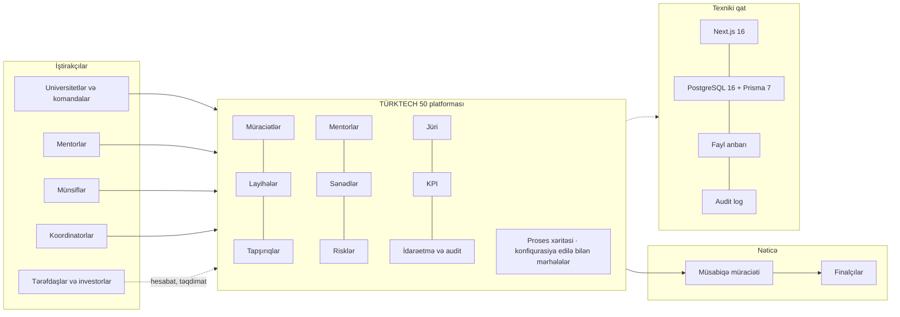

# TÜRKTECH 50 — proses mərhələləri (workflow)

> Sistem qərar vermir: seçim və münsif qərarlarını insanlar verir. Platforma qeyd edir, prosesi görünən edir və hesabat verir.

Bu sənəd proqramın proses axınını, hər mərhələnin məsulunu və nəticəsini, platformadakı sistem statusunu, konfiqurasiya qaydalarını və təqdimat diaqramlarını təsvir edir.

## 1. Mərhələlər cədvəli (default)

| # | Mərhələ (AZ) | TR | Kim (məsul) | Nə edir | Nəticə | Sistem statusu | Keçid |
|---|---|---|---|---|---|---|---|
| 1 | Müraciət | Başvuru | Komanda | Müraciət formasını göndərir (problem, həll, komanda) | Müraciət qeydə alınır | `Application.status = SUBMITTED` | avtomatik |
| 2 | İlkin baxış — seçim rubriki | Ön değerlendirme — seçim rubriği | Münsif, koordinator | Seçim rubriki ilə bal verir (məsləhət xarakterli) | Ballar və şərhlər | `UNDER_REVIEW` (ilk bal göndəriləndə) | avtomatik |
| 3 | ◇ Qərar: qəbul | Karar: kabul | Koordinator | Əsaslandırma ilə qərar qeyd edir | Komanda qəbul edilir | `ACCEPTED` | avtomatik (qərar paneli) |
| 3a | Gözləmə siyahısı | Yedek liste | Koordinator | Yer boşalarsa dəvət | Yan yol (sarı) | `WAITLIST` | avtomatik |
| 3b | Rədd edildi | Reddedildi | Koordinator | Əsaslandırma ilə rədd | Yan yol (qırmızı) | `REJECTED` | avtomatik |
| 4 | Layihə sahəsi açılır | Proje alanı açılır | Koordinator, komanda | Layihə, 13 bəndlik sənəd checklist-i, komanda hesabı yaradılır | Layihə `VALIDATION`-da başlayır | `Application.projectId != null` | avtomatik |
| 5 | Validasiya | Doğrulama | Komanda, mentor | Problem və istifadəçi ehtiyacı yoxlanılır | Təsdiqlənmiş problem | `Project.stage = VALIDATION` | avtomatik |
| 6 | Prototip | Prototip | Komanda, mentor | İlk işlək prototip | Prototip + test | `PROTOTYPE` | avtomatik |
| 7 | MVP | MVP | Komanda, mentor | Minimum işlək məhsul, test sübutu | KPI: işlək prototip/MVP | `MVP` | avtomatik |
| 8 | Ara münsif | Ara jüri | Münsif, koordinator | `MIDTERM` rubriki ilə qiymətləndirmə | Rəy, düzəlişlər | `QA` | avtomatik |
| 9 | Sınaq finalı | Deneme finali | Münsif, komanda | `FINAL` rubriki ilə pitch + demo məşqi | Final hazırlığı | `QA` + göndərilmiş `FINAL` qiymətləndirməsi | avtomatik |
| 10 | Müsabiqəyə müraciət | Yarışmaya başvuru | Komanda, koordinator | Paket QC-dən keçir, müsabiqəyə göndərilir | KPI: QC paketi | `SUBMITTED` | avtomatik |
| 11 | ◇ Nəticə: finalçı | Sonuç: finalist | Koordinator | Rəsmi nəticəni qeyd edir | KPI: finalçı | `CompetitionResult = FINALIST` | avtomatik |
| 11a | Nəticə: seçilmədi | Sonuç: seçilmedi | Koordinator | Dərslər, növbəti müsabiqə | Yan yol (qırmızı) | `NOT_SELECTED` | avtomatik |

**Paralel axınlar** (bütün inkubasiya boyunca, diaqramda yan zolaq): mentor görüşləri (plan → qeyd → növbəti addım tapşırığa çevrilir), tapşırıqlar (Kanban, Meyar), sənəd yoxlama siyahısı (13 bənd, versiya, QC), risklər (3×3 matris).

**KPI hunisi (pilot hədəfləri):** 150 qiymətləndirilmiş müraciət → 100 qəbul edilmiş komanda → 50 işlək prototip/MVP → 50 QC-dən keçmiş paket → 10 finalçı. Proses səhifəsində plan və faktiki rəqəmlər (faktiki — yalnız koordinatora) göstərilir.

## 2. Konfiqurasiya qaydaları

- Mərhələlər `WorkflowStage` cədvəlindədir: `scope` (`APPLICATION` | `PROJECT`), `systemKey`, `nameAz/Tr/En`, `descriptionAz/Tr/En`, `order`, `kind` (`NORMAL` | `DECISION` | `WAITING` | `REJECTED` | `DONE`), `responsibleRoles` (birinci rol = diaqramda əsas zolaq), `active`. Hər layihə/müraciətdə `workflowStageId`, keçidlər `WorkflowTransition`-dadır (kim, nə vaxt, haradan → haraya, avtomatik/əl ilə, qeyd).
- **Sistem mərhələləri** (`systemKey` dolu) mövcud enum-lara bağlıdır və mövcud axınlar (qərar paneli, aşama dəyişikliyi, FINAL rubriki, müsabiqə nəticəsi, layihə sahəsinin yaradılması) onları avtomatik dəyişir. Onları silmək/deaktiv etmək olmaz; adını, təsvirini, məsul rolları və sırasını dəyişmək olar.
- **Fərdi mərhələlər** (`systemKey = null`) `/admin/workflow`-da əlavə olunur (yer, 3 dildə ad/təsvir, növ, rollar), yalnız əl ilə keçilir; deaktiv edilə və silinə bilər — içində element varsa əvvəlcə başqa aktiv mərhələyə köçürülür.
- **Əl ilə keçid** (root və koordinator): layihə/müraciət səhifəsindəki stepper-də “Mərhələni dəyiş” (qeyd məcburidir). Sistem mərhələsinə keçid bağlı sahəni də yeniləyir (layihədə `stage`/`result`, müraciətdə `status` + qərar əsaslandırması); fərdi mərhələ yalnız prosesdəki yeri dəyişir. Hər keçid `AuditLog`-a (`workflow.move`, `workflow.auto`, `workflow.stage_*`) yazılır, komanda bildiriş alır.
- **Görünürlük (RBAC):** koordinator/root — hamısı; münsif — təyin olunduğu layihələr + bütün müraciətlər (seçim rubriki üçün); mentor — təyin olunduğu layihələr; komanda — yalnız öz layihəsi/müraciəti.

## 3. Platformada

- `/process` — canlı proses xəritəsi (bütün rollar): rol zolaqlı SVG diaqram, canlı saylar, qərar nöqtələri, gözləmə/rədd yolları, paralel axınlar, KPI hunisi; mərhələyə klik → siyahı; “Təqdimat rejimi” (tam ekran, böyük şrift), “SVG yüklə” / “PNG yüklə” (2x).
- `/admin/workflow` — mərhələlərin idarəsi (root, koordinator).
- `/projects/[id]` və `/applications/[id]` — stepper: keçilmiş/cari/növbəti, tarixlər, “növbəti addım və məsul rol”, keçid tarixçəsi, “Mərhələni dəyiş”.

## 4. Statik diaqramlar (jüri, investor, TTO təqdimatı)

`docs/diagrams/` — AZ və TR, SVG + PNG (2x):

| Diaqram | AZ | TR |
|---|---|---|
| Workflow (rol zolaqları, qərar nöqtələri, alternativ yollar, paralel axınlar, KPI hunisi) | `workflow-az.svg/png` | `workflow-tr.svg/png` |
| Arxitektura (iştirakçılar → platforma və modullar → nəticə; texniki qat) | `architecture-az.svg/png` | `architecture-tr.svg/png` |
| Rollar və icazələr matrisi | `roles-az.svg/png` | `roles-tr.svg/png` |

Yenidən yaratmaq: `node docs/diagrams/generate.mjs` (SVG, asılılıq yoxdur), sonra `node docs/diagrams/render-png.mjs` (PNG; `puppeteer-core` + Chromium lazımdır — yolları `PUPPETEER_CORE`, `CHROME`, `CHROME_LIBS` ilə vermək olar; Inter şrifti üçün işləyən tətbiq: `T50_FONT_ORIGIN=http://127.0.0.1:3051/login`).

## 5. Mermaid mənbələri

### 5.1 Workflow (rol zolaqları)

Paralel axınlar (Validasiya → Müsabiqəyə müraciət boyunca):

KPI hunisi:

### 5.2 Layihənin vəziyyət diaqramı

### 5.3 Arxitektura

## 6. Canlı bazaya tətbiq (miqrasiya)

Miqrasiya `prisma/migrations/20261102120000_workflow_stages` yalnız **əlavə edir**: 2 yeni enum, 2 yeni cədvəl, `Application` və `Project`-də nullable `workflowStageId`; 14 default mərhələni `INSERT … ON CONFLICT DO NOTHING` ilə yaradır və mövcud müraciət/layihələri statuslarına görə uyğun mərhələyə bağlayır. `DROP`/`DELETE` yoxdur. Sonra `npm run workflow:sync` (idempotent) çatışmayanları tamamlayır və mövcud tarixlərdən (`submittedAt`, `decidedAt`, `StageChange`) başlanğıc keçid tarixçəsini yaradır. **`npm run db:seed` canlı bazada işlədilməməlidir** (bütün cədvəlləri sıfırlayır).

## 7. Testlər

- `npm test` — mərhələ məntiqi (default sıra, miqrasiya SQL ↔ kod uyğunluğu, status → mərhələ xəritəsi, əl ilə keçidin tərsi, diaqram düzülüşü). `T50_DB_TEST=1 npm test` əlavə olaraq dev bazada `workflow:sync`-in idempotent olduğunu yoxlayır (yalnız `*_dev` / `*_merge` test bazasında işləyir).
